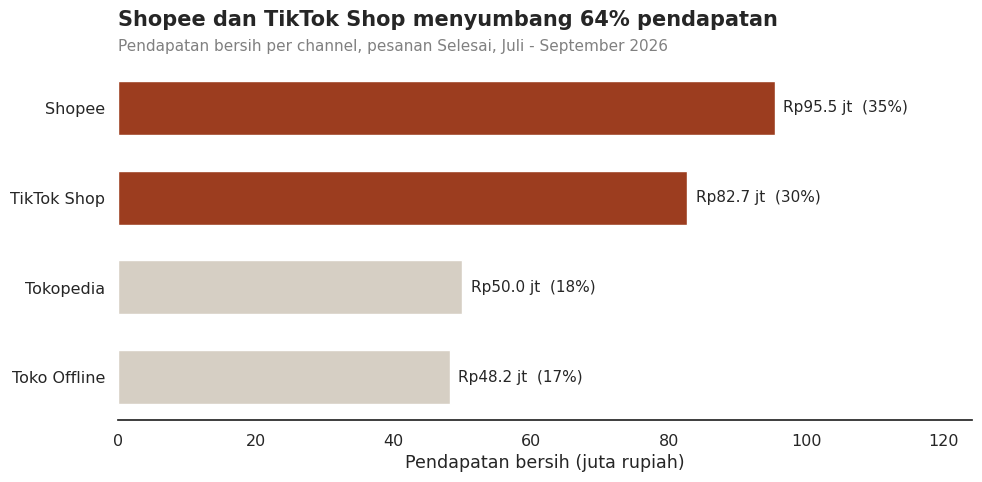
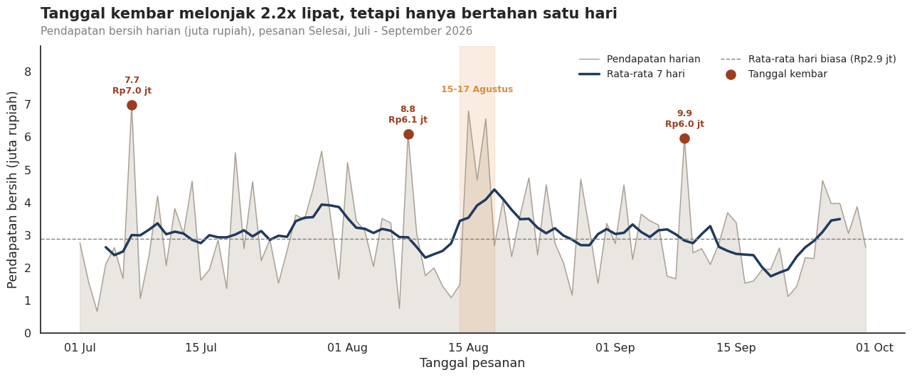
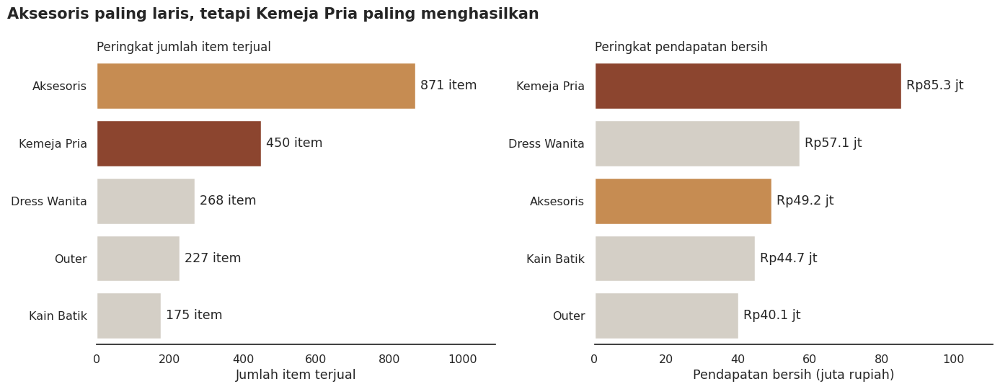
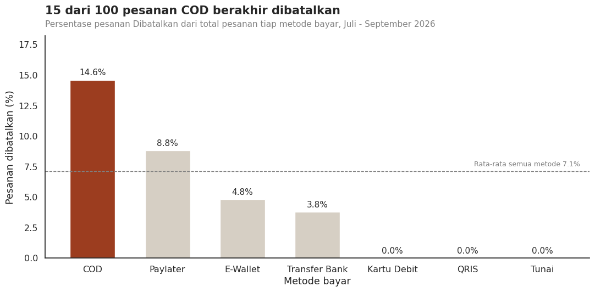

# Batik Lestari: Q3 Sales Performance & Data Visualization

**Python · Pandas · Matplotlib · Seaborn | FGSeara Group Project**

## Project Overview

This project analyzes July–September 2026 sales for **Batik Lestari**, a **fictional** Indonesian batik retailer, to inform Q4 campaign and operational priorities. The project was completed collaboratively as part of FGSeara's Python for Data Analytics session.

**My contribution:** I developed the Section 5 data visualizations, chose chart types, formatted axes/labels and annotations, and summarized the visible trends. Data cleaning, broader analysis, and recommendations were collaborative team work.

## 1. Problem

The business needed to determine which sales channels, product categories, and campaign dates deserved attention, and which payment processes had higher cancellation rates. The raw sales data had duplicate records, inconsistent labels, and missing values.

## 2. Data

- **Source:** FGSeara learning dataset (fictional), July 1–September 30, 2026.
- **Initial dataset:** 1,206 rows, 12 columns; one row per order.
- **After removing exact duplicates:** 1,180 rows; 1,062 orders had status `Selesai` and were used for revenue charts.
- **Quality checks:** duplicate rows, inconsistent text values, date conversion, missing buyer cities and missing ratings.
- **Revenue definition:** `harga_satuan × jumlah × (1 − diskon_persen / 100)` for **completed orders only**; this is sales after discount, **not accounting profit**.

See [the original CSV](data/batik_lestari_q3_sales.csv) and [analysis notebook](notebooks/BatikLestari_Q3_Analysis.ipynb).

## 3. Approach

The team cleaned and explored the data using Pandas. For my visualization section, I selected:

1. **Horizontal bar chart** to compare completed-order revenue across sales channels.
2. **Daily line chart** with 7-day moving average and highlighted double-date campaigns.
3. **Side-by-side bar charts** to distinguish units sold from sales revenue by category.
4. **Cancellation rate bar chart** to compare `Dibatalkan / all orders` within each payment method.

The selection emphasizes business questions rather than chart variety alone.

## 4. Results

### Sales channel contribution

Shopee generated **Rp95.47 million** and TikTok Shop **Rp82.73 million**. Together they represented **64.46%** of completed-order revenue.

### Daily revenue and double-date promotions

Double-date revenue was approximately **Rp6.99 million (7.7)**, **Rp6.09 million (8.8)**, and **Rp5.97 million (9.9)**. The overall mean was around **Rp3.00 million/day**, while the mean excluding the three double-date days was approximately **Rp2.90 million/day**.

### Product category: units vs revenue

Accessories led units sold (**871 items**), while men's shirts led revenue (**Rp85.31 million**, from **450 items**). Ranking product categories by units alone would miss this distinction.

### Payment cancellation risk

COD had the highest cancellation rate (**14.60% of COD orders**). This denominator is important: it is **not** COD's share of all canceled orders.

## 5. Impact / Recommendations

- **Prioritize testing promotional campaigns** on Shopee and TikTok Shop, as they contribute most of observed Q3 revenue. Ad-budget proportions should be evaluated with campaign ROI, not assumed from revenue share alone.
- **Prepare category-specific Q4 stock** using both unit-demand and revenue rankings: accessories are high-volume while men's shirts have higher sales value.
- **Review COD fulfillment and cancellation causes**, and test interventions before restricting payment methods.

These are **proposed recommendations**; implementation outcomes and causality were **not measured**.

## 6. Tools & Links

- Tools: Python, Pandas, Matplotlib, Seaborn, Google Colab.
- [Run / review the analysis notebook](notebooks/BatikLestari_Q3_Analysis.ipynb)
- [Visualization images](visualizations/)
- [Learning dataset](data/batik_lestari_q3_sales.csv)

## Team & My Contribution

**FGSeara Group 1**. This was a group analysis. I was responsible specifically for the visualizations in the notebook's Section 5 and contributed to communicating their takeaways. Other project stages were collaborative. The source learning dataset and final slide deck are not proprietary business records.

## Limitations and Reproducibility

- The business and dataset are fictional, produced for learning.
- The notebook references a local CSV in `data/` and should be run from the repository root; package versions may affect chart rendering.
- The included notebook is a **portfolio-adjusted copy** with a corrected file path, cleaned-data revenue reference, correct P4 denominator, and minor date/wording fixes compared with the original group notebook.
- The original group slide deck contained an inconsistent total-revenue figure (**Rp248,599,100**). The revenue reported here (**Rp276,425,900**) is verified against the supplied CSV under the stated completed-order definition.
- Observational patterns in Q3 cannot guarantee results during Q4, and no experimental or causal effects were estimated.
